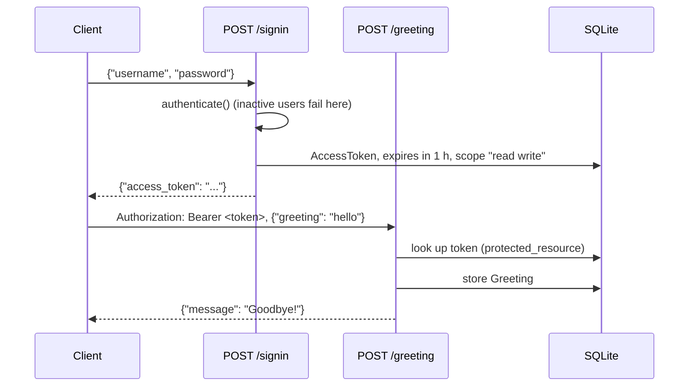

# OAuth-protected greeting exercise

A small Django exercise in credential checking, bearer-token issuing and a protected JSON endpoint. A user signs in with a username and password, gets a one-hour access token from Django OAuth Toolkit, and uses it to post a greeting. `hello` (any case, surrounding spaces ignored) is answered with `Goodbye!`; anything else gets `Greeting received!`. Accepted greetings are stored in SQLite.

The repository name comes from its original context, but the code has no courses, enrollment, lessons or LMS. What it shows is the request and authentication path.

## How a request flows



`/signin` is a shortcut, not an OAuth grant: it checks the password itself and writes the token row directly, attaching the first stored OAuth application if one exists. `/greeting` is guarded by the toolkit's `protected_resource` decorator, so any valid, unexpired token from the toolkit is accepted, including ones issued through the standard endpoints mounted under `/o/`.

## Run it with Docker

```sh
docker compose up --build
```

The container applies migrations on start and keeps the database in the `greeting-data` volume. The API listens on `http://localhost:8000`. Create a user to sign in with:

```sh
docker compose exec api python manage.py createsuperuser
```

Settings come from the environment; `.env.example` lists them. Without `DJANGO_SECRET_KEY` a random key is generated per process, which is fine for trying it out (admin sessions just won't survive a restart). Setting `DJANGO_DEBUG=0` makes the key mandatory.

## Run it without Docker

Python 3.12 (see `.python-version`):

```sh
python -m venv .venv
source .venv/bin/activate
pip install -r requirements.txt
python manage.py migrate
python manage.py createsuperuser
python manage.py runserver 127.0.0.1:8000
```

## API

Both routes take POST with a JSON object body and have **no trailing slash**. Other methods get `405`.

| Route | Auth | Success | Errors |
| --- | --- | --- | --- |
| `POST /signin` | none | `200 {"access_token": ...}` | `400` for malformed JSON, missing fields or wrong/inactive credentials |
| `POST /greeting` | `Bearer` token | `200 {"message": ...}` | `403` without a valid token, `400` for a blank or non-string greeting |

These exchanges were captured from the Docker setup above with a throwaway local user (the token is replaced by a placeholder):

```http
POST /signin
Content-Type: application/json

{"username": "demo", "password": "demo-pass-2026"}

HTTP/1.1 200 OK
{"access_token": "<30-character token>"}
```

```http
POST /greeting
Authorization: Bearer <access_token>
Content-Type: application/json

{"greeting": "hello"}

HTTP/1.1 200 OK
{"message": "Goodbye!"}
```

The same token with `{"greeting": "good morning"}` returns `{"message": "Greeting received!"}`. The error cases look like this:

| Request | Status | Body |
| --- | --- | --- |
| `/signin` with a wrong password | 400 | `{"error": "User did not authenticate"}` |
| `/signin` with only a username | 400 | `{"error": "username and password are required"}` |
| `/greeting` with `{"greeting": "  "}` | 400 | `{"error": "A nonempty greeting string is required"}` |
| `/greeting` without `Authorization` | 403 | empty |
| `GET /greeting` with a valid token | 405 | `{"error": "Only POST requests are allowed"}` |

Do not paste real tokens into logs, issues or docs.

## Tests and lint

```sh
python manage.py test core
pip install -r requirements-dev.txt
ruff check . && ruff format --check .
```

Twenty tests in `core/tests.py` cover sign-in (valid, wrong and unknown credentials, missing fields, malformed and non-object JSON, inactive accounts, GET) and the greeting endpoint (both replies, stored text, blank and non-string greetings, unknown and expired tokens, missing token, GET). Token lifetime and scope are checked too. They do not run a full external OAuth flow.

## Limits

- No sign-in throttling, audit trail, account registration or token revocation endpoint of its own.
- `runserver` is used in the container; TLS, a production WSGI server and deployment settings are separate work.
- The `Profile` model and its admin page exist, but nothing in the API reads or writes profiles.

## License

MIT, see `LICENSE`.
